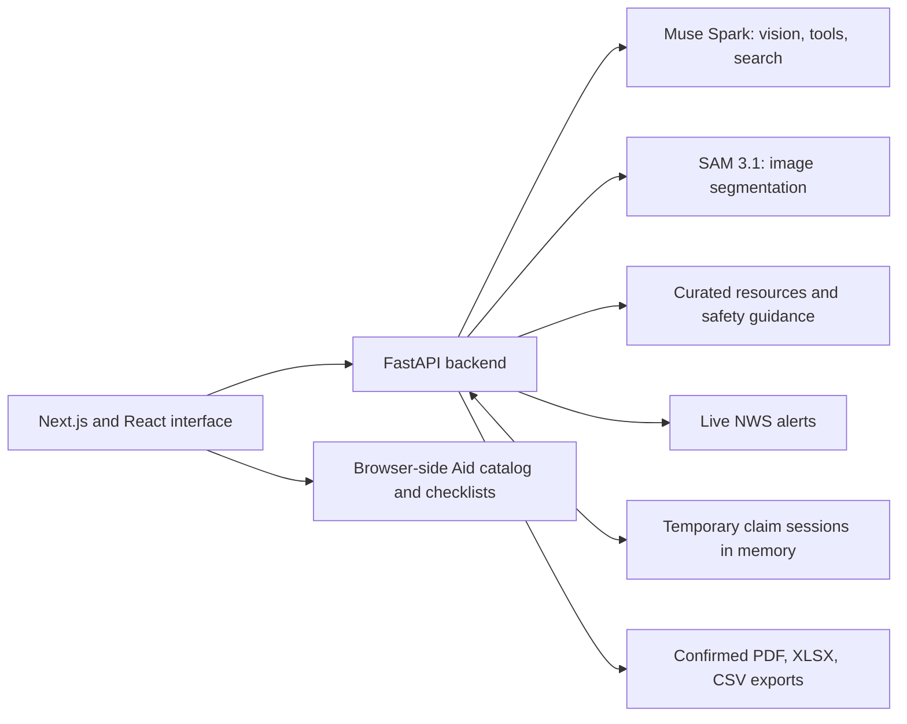

# What Next

**Lost your home? Start here.**

What Next helps people find their next step after a disaster: locate recovery resources, organize paperwork, and rebuild a belongings inventory from photos they already have.

Wren, the visual assistant, turns questions into maps, action cards, and sourced guidance. The claims helper uses Meta Muse Spark and SAM 3.1 to identify and outline belongings, then lets the user review them before exporting an inventory.

Built by James, a Virginia Tech student, for the **Meta × Cerebral Valley AI Hackathon, indie developer track**. The idea grew from experiencing the 2024 flooding in Virginia's New River Valley; the app's **Our Story** page explains that personal starting point.

[Judge walkthrough](#judge-walkthrough) · [Run locally](#run-locally) · [Meta model integration](#meta-model-integration) · [Privacy and safeguards](#privacy-and-safeguards)

## What you can try

| Feature | What it does | App route |
| --- | --- | --- |
| **Ask Wren** | Uses tools to show alerts, nearby resources, a Today / This week / Deadlines plan, and pre-authored safety guidance beside an interactive map. | `/agent` |
| **My Claim** | Scans selected photos, outlines belongings, compares duplicates across photos, supports corrections and confirmation, and exports PDF, XLSX, or CSV. | `/claims` |
| **Memory Web** | Connects rooms and confirmed belongings to related things the user may have forgotten. Selecting an item or room opens related suggestions and their evidence workflow. | `/claims#memory` |
| **Aid Autopilot** | Asks five optional questions, reviews the situation, filters sample assistance programs, and prepares document checklists and printable or JSON summaries. | `/aid` |
| **Recovery Toolkit** | Orders document replacement steps by prerequisites, with a Virginia guide, and helps prepare an insurer call. | `/toolkit` |
| **Our Story** | Explains the personal experience and recovery problem behind the project. | `/our-story` |

The interface includes phone layouts, light and dark themes, keyboard controls, reduced-motion support, and an 11-stop **Take a tour** walkthrough available from the header or footer. No account is required.

## Judge walkthrough

Start at **http://localhost:3000** after following the setup below. Use **Take a tour** for an overview, or try this path:

1. **Ask Wren:** choose a demo scenario and send: `I need shelter tonight and a plan for what to do first`. Inspect the resource cards, map, source links, and alert timestamps. Asking for safety guidance opens a sourced step-by-step flow.
2. **Rebuild an inventory:** open **My Claim**, select a few staged room or belongings photos, and scan them. Review the detections and photo outlines, correct details, inspect cross-photo merges, and confirm what you owned.
3. **Explore Memory Web:** select a confirmed item or room to see related suggestions. A suggestion becomes an inventory item only after a supporting photo is processed and the user confirms it. The graph supports pan, wheel zoom, touch pinch, Reset, and Fit.
4. **Export:** download a PDF, spreadsheet, or CSV containing confirmed items. Where available, inspect the replacement-cost estimate and its source. Use **Finish and delete photos** when done.
5. **Explore aid:** open **Aid Autopilot**, answer or skip the optional questions, and review the results. Open **Help me prepare** on a program. **Ask Wren** prepares a draft for review; the user must press **Send** to send it.

Private demo photos are intentionally excluded from the repository. Use staged photos you are comfortable processing. In mock mode, the scan returns the same clearly labeled sample sofa, lamp, and rug for every photo; this exercises the interface, not recognition quality.

### Live services and demo data

| Part | Current behavior |
| --- | --- |
| Models | Real Muse Spark and SAM requests when a model key is configured; labeled mock responses without one, or with `MOCK=1`. |
| Weather alerts | National Weather Service alerts fetched on demand for the selected scenario's coordinates. Historical replay alerts are labeled separately. Network failures are shown in the UI. |
| Wren's map and resources | Curated, sourced scenario content for the Spokane Complex Fires and a **hypothetical** New River Valley flood. The map follows the selected demo scenario, not the user's verified location. |
| Aid Autopilot | A static demo catalog filtered in the browser by disaster type and needs. It does not verify an address, an active declaration, program availability, or eligibility. |
| Applications and claims | The app prepares information and exports. It does not submit applications, file insurance claims, or determine awards or coverage. |

## Run locally

### Prerequisites

- **Node.js 20.9 or newer** and npm.
- **Python 3.11 or newer** with `venv` and pip. The development environment uses Python **3.15** on Windows.
- Internet access for dependency installation, map tiles, live alerts, and live model calls. The build also downloads the configured Google fonts.
- A Meta Model API key for real model inference. You can explore the app without a key using mock mode.

### Windows / PowerShell

Run these commands from the repository root:

```powershell
npm run setup
Copy-Item .env.example .env
npm run dev
```

Leave the keys blank for a mock demo, or set them in `.env` before starting the app. If `.env` already exists, edit it instead of copying over it.

Open **http://localhost:3000**. The Next.js frontend runs on port **3000**, and the FastAPI backend runs on **8000**. Next.js forwards `/api/*` requests to the backend. The API reference is at **http://localhost:8000/docs**, and `/api/health` reports mock mode and the configured model IDs.

`npm run stop` stops the Windows development servers. Restarting the backend clears claim sessions because they are held in memory.

<details>
<summary>Manual setup on macOS or Linux</summary>

The root setup and combined development scripts use Windows paths. Install and launch the two apps separately:

```bash
npm install
npm --prefix apps/web install
python3 -m venv apps/api/.venv
apps/api/.venv/bin/python -m pip install -r apps/api/requirements.txt
cp .env.example .env
```

Start the backend in one terminal:

```bash
cd apps/api
.venv/bin/python -m uvicorn app.main:app --port 8000
```

Start the frontend from the repository root in another terminal:

```bash
npm --prefix apps/web run dev
```

This is the manual equivalent of the Windows setup; Windows is the development environment tested for this prototype.

</details>

### Model configuration

Keys are read by the backend from the root `.env` file. They are not exposed through frontend environment variables.

| Variable | Purpose |
| --- | --- |
| `MODEL_API_KEY` | Default Meta key for claim image understanding and the other model calls. One key can serve the whole app. |
| `SAM_API_KEY` | Optional separate key for SAM segmentation, including any Files API fallback. Defaults to the Spark key. |
| `WREN_API_KEY` | Optional separate key for Wren. If `MODEL_API_KEY` is blank, this also powers Spark image understanding and other Spark calls. |
| `MODEL_BASE_URL` | Meta API endpoint; defaults to `https://api.meta.ai/v1`. |
| `MOCK` | Set to `1` to force mock model responses even when keys are configured. |
| `SESSION_TTL_MINUTES` | Inactive claim-session expiry interval; defaults to `60`. |

Without a Spark key from `MODEL_API_KEY` or `WREN_API_KEY`, the backend uses mock mode. A SAM key alone does not enable live scanning. Live model calls use the configured Meta account and may incur API charges. Restart the backend after changing its environment.

## Meta model integration

| Model configured in this project | Role |
| --- | --- |
| **Muse Spark 1.3** (`muse-spark-1.3`) | Identifies belongings and classifies photos; compares item crops across photos; generates Memory Web suggestions; uses web search for replacement-cost estimates; powers Wren's tool calls and Toolkit follow-up answers. |
| **SAM 3.1** (`sam-3.1`) | Segments the categories identified by Spark, producing item masks and bounding boxes for overlays and crops. Also checks supporting photos when adding a suggested belonging. |

The photo pipeline runs **Spark identification → SAM segmentation → cross-photo comparison → user review → confirmed export**. Structured results used for inventory and tools are constrained or validated through schemas; SAM streams are decoded with the Meta SAM parser. Segmentation failures leave identified items available for review with a warning.

Memory Web also shows rule-based evidence grades using photo dates, the number of supporting photos, and a recorded brand. These grades help the user strengthen documentation; they are not a certification of ownership.

Wren calls tools such as `get_alerts`, `find_resources`, `build_plan`, `show_safety_flow`, `start_claim`, and `open_toolkit`. The backend returns typed UI instructions, which the frontend renders as cards and map content. Addresses, programs, and safety steps come from tool data rather than free-form model prose.

Replacement-cost estimates are accepted only when a specific listing URL appears in the model's search metadata and the range passes validation. They remain estimates for the user to check, not appraisals or proof of ownership.

Model selection and key routing live in [config.py](apps/api/app/config.py), with the API integration in [model_client.py](apps/api/app/model_client.py) and [agent.py](apps/api/app/agent.py). The code uses standard model IDs and rejects `-contributor` variants.

## How it works



- **Frontend:** Next.js, React, TypeScript, Tailwind CSS, MapLibre GL, and d3-force with SVG for Memory Web.
- **Backend:** FastAPI, Pydantic, Pillow with HEIC support, the OpenAI-compatible Meta client, the Meta SAM parser, openpyxl, and fpdf2.
- **Content:** sourced JSON and GeoJSON files. The prototype does not run a background ingestion scheduler or use a persistent user database.

| Directory | Contents |
| --- | --- |
| [`apps/web`](apps/web) | Interface, guided tour, map, claims flow, Aid Autopilot, and Toolkit. |
| [`apps/api`](apps/api) | Model calls, image processing, session handling, merging, valuation, and export. |
| [`packages/shared`](packages/shared) | Shared TypeScript types and the project/agent names in `brand.json`. |
| [`content`](content) | Scenario resources, programs, fire perimeters, safety flows, and document guides with sources. |
| [`scripts`](scripts) | Optional model diagnostics, photo-asset preparation, and Windows development helpers. |
| [`docs`](docs) | Aid implementation notes, frontend design/audit notes, and image credits. |

## Privacy and safeguards

**Photo processing is opt-in.** The app processes the photos the user selects. Images are re-encoded without embedded EXIF/GPS metadata before model calls and export; extracted dates and GPS are held as temporary session metadata. Live mode sends image content and the prompts needed for processing to Meta's API. SAM tries inline images first; if the Files API fallback is needed, the app requests deletion of the remote upload after use.

**Claim sessions are temporary.** Processed photos and inventory results are held in backend memory. **Finish and delete photos** ends the session explicitly. The browser also attempts cleanup when leaving the page. Inactive sessions expire after the configured interval and are removed during later session activity; restarting the backend clears all sessions.

**Browser storage varies by feature.** Wren's conversation uses this tab's `sessionStorage`. Toolkit drafts/checklists and theme preferences use device-local storage when available. Aid answers, notes, saved links, and progress stay in browser memory and clear on reload or **Clear my aid details**. An Aid handoff contains the selected program and confirmed situation, excluding preparation notes, checklists, and photos.

**The user decides what enters the inventory.** Exports include only confirmed items. Memory Web suggestions require a supporting photo and confirmation. Duplicate merges can be reviewed and undone. Photos classified as documents, IDs, or screenshots are skipped for item extraction; that classification occurs after upload and is not a pre-upload privacy filter.

**Safety content has boundaries.** Safety flows are pre-authored from cited official guidance. Emergency language is checked before Wren makes a model call and directs the user to emergency services. The app provides general guidance, not local emergency orders, insurance decisions, or legal advice.

## Current scope and limitations

This is a working hackathon prototype. Resource records and program guidance are snapshots with source links and review dates; source links do not establish current availability or eligibility. Photo recognition, segmentation, merging, and valuations can be wrong and require human review. The document replacement guide currently covers Virginia. There is no account system, production access control, or automatic application submission.

The prototype has not been evaluated for real disaster response or insurer acceptance. Its intended demonstration is the user-controlled workflow from a question or selected photo to a clearer next step.

## Development and checks

From the repository root on Windows:

```powershell
npm run test:web
npm run test:api
npm --prefix apps/web run lint
npm --prefix apps/web run build
```

The API test configuration forces mock model responses, so the suite does not make paid inference calls. Tests cover image metadata handling, model-key routing, item schemas, SAM parsing, merge rules, export confirmation, agent routing, document ordering, Aid filtering and handoff redaction, graph layout/gestures, theme behavior, and shipped slideshow assets.

For API tests on macOS/Linux, run `cd apps/api` and `.venv/bin/python -m pytest -q`.

The optional `scripts/day1_model_test.mjs` diagnostic makes real model requests on photos in `scripts/test_photos/`; it requires the scripts package dependencies and `MODEL_API_KEY`. It is separate from the automated test suite.

Keep real keys in the ignored `.env` file and private test photos outside tracked source. Keep project and agent names centralized in [`brand.json`](packages/shared/brand.json). Changes should preserve user confirmation, evidence requirements, source attribution, and the existing privacy and safety boundaries.

Further implementation notes: [Aid Autopilot](docs/AID_AUTOPILOT.md), [frontend redesign](docs/FRONTEND_REDESIGN.md), and [frontend audit](docs/FRONTEND_AUDIT.md). Image sources and their recorded attribution/permission status are documented in [Image credits](docs/IMAGE_CREDITS.md); some supplied photographs are still marked unverified there.
